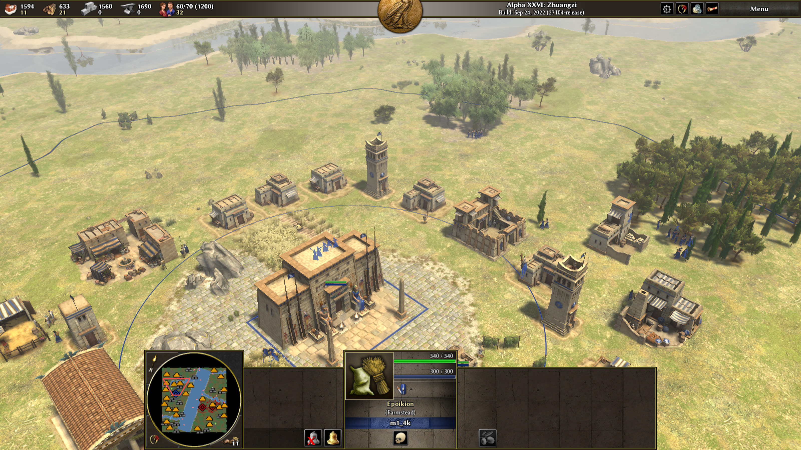

# Han River (한강)

0 A.D. 용 랜덤 맵 모드입니다.



## 맵 설명

넓은 강이 맵을 동서 방향으로 가로지릅니다. 플레이어들은 강의 남북 양쪽 둑으로 나뉘어 시작하며, 얕은 여울목이 핵심 교전 포인트가 됩니다.

## 특징

- **강**: 맵 중앙을 가로지르는 주 강. 게임마다 방향이 무작위로 회전됩니다.
- **지류**: 주 강에서 뻗어 나오는 얕은 지류 (4~16개, 맵 크기에 비례).
- **지형**: 언덕 또는 산이 무작위로 생성됩니다.
- **자원**: 금속, 돌, 과일 덤불, 사냥감, 강 낚시 지원.
- **바이옴**: 모든 바이옴 지원 (`generic/` 계열).
- **노마드 모드**: 지원.

## 파일 구성

```
maps/random/
├── han_river.js      # 맵 생성 스크립트
├── han_river.json    # 맵 메타데이터 (이름, 설명, 썸네일 등)
└── han_river.png     # 썸네일 이미지
```

## 설치 방법

`maps/` 폴더 전체를 0 A.D. 유저 모드 디렉터리에 복사합니다.

| 운영체제 | 경로 |
|----------|------|
| Windows  | `%APPDATA%\0ad\mods\<모드명>\` |
| macOS    | `~/Library/Application Support/0ad/mods/<모드명>/` |
| Linux    | `~/.local/share/0ad/mods/<모드명>/` |

그 다음 0 A.D. 실행 → **설정 > 모드** 에서 해당 모드를 활성화하면 맵 선택 화면에 Han River가 표시됩니다.

## 요구 사항

- 0 A.D. Alpha 26 (0.0.26) 이상
